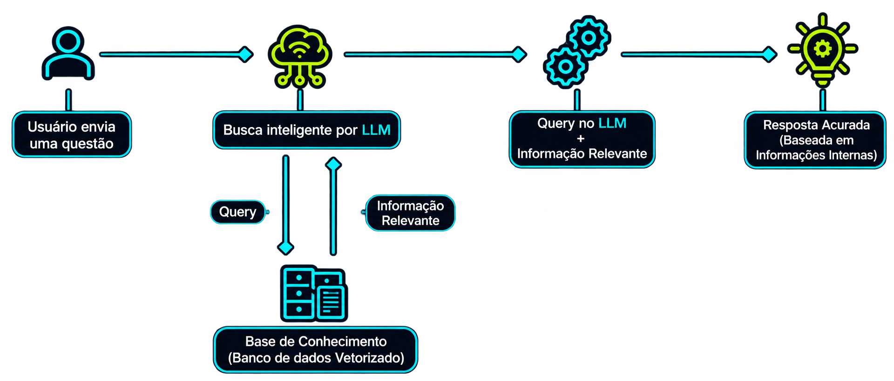

# Retrieval-Augmented Generation (RAG) - Geração de Recuperação Aumentada

Técnica que combina **recuperação de informações externas (Retrieval)** com **geração de texto por modelos de linguagem (Generation)**.

Permite que um LLM consulte fontes externas de conhecimento antes de gerar uma resposta, utilizando informações específicas e atualizadas.

**Objetivos:**
- Melhorar a precisão e a contextualização das respostas.
- Reduzir a ocorrência de alucinações (*Hallucinations*).
- Permitir a utilização de dados externos ou proprietários sem precisar retreinar o modelo.

**Importante:** o RAG não modifica os parâmetros do LLM nem realiza seu treinamento. Ele fornece informações adicionais ao modelo durante a geração da resposta.

---

## **Vantagens**

- Acesso a informações externas e atualizadas.
- Utilização de dados proprietários.
- Redução de alucinações.
- Maior contextualização das respostas.
- Possibilidade de apresentar as fontes utilizadas.
- Atualização da base de conhecimento sem retreinamento do LLM.

## **Desvantagens**

- Dados incorretos ou desatualizados comprometem as respostas.
- Maior latência devido à etapa de recuperação.
- Complexidade adicional de implementação e manutenção.
- Custos computacionais e de armazenamento.
- Não elimina completamente as alucinações.

---

## **Funcionamento**

O RAG possui duas etapas principais:

### **1. Indexação (Indexing)**

Preparação dos documentos para permitir consultas posteriores.

1. **Ingestão:** coleta de documentos e informações de fontes externas.
2. **Chunking:** divisão dos documentos em pequenos trechos (*chunks*).
3. **Embeddings:** transformação dos trechos em representações numéricas (vetores).
4. **Armazenamento:** registro dos vetores e dos documentos em um índice ou banco de dados.

### **2. Recuperação e Geração (Retrieval and Generation)**

Processo realizado quando o usuário faz uma pergunta.

1. **Consulta:** o usuário envia uma pergunta.
2. **Vetorização:** a pergunta é transformada em um vetor (*Embedding*).
3. **Recuperação:** o sistema busca os trechos mais relevantes na base de conhecimento.
4. **Enriquecimento:** os trechos recuperados são adicionados ao contexto da pergunta (*Prompt Augmentation*).
5. **Geração:** o LLM utiliza a pergunta e o contexto recuperado para produzir uma resposta.

**Observação:** a indexação geralmente acontece antecipadamente, enquanto a recuperação e a geração acontecem durante a consulta.

---

## **Principais conceitos**

### **Embeddings**

Representações numéricas (vetores) de informações, como textos, utilizadas para representar seus significados semanticamente.

- Permitem comparar a similaridade entre textos.
- Textos semanticamente semelhantes tendem a apresentar vetores próximos.
- São utilizados tanto na representação dos documentos quanto das consultas.

### **Chunking**

Técnica de dividir documentos maiores em pequenos trechos (*chunks*).

- Facilita a recuperação de informações específicas.
- Evita enviar documentos inteiros e desnecessários ao LLM.
- Pode utilizar sobreposição entre trechos (*Chunk Overlap*) para preservar o contexto.

### **Vector Database (Banco de Dados Vetorial)**

Banco de dados especializado no armazenamento e na recuperação de vetores (*Embeddings*).

Permite encontrar documentos semanticamente semelhantes a uma consulta.

### **Similarity Search (Busca por Similaridade)**

Mecanismo que identifica vetores semelhantes em um espaço multidimensional.

Principais métricas:
- **Cosine Similarity:** compara o ângulo entre vetores.
- **Euclidean Distance:** calcula a distância geométrica entre vetores.
- **Dot Product:** utiliza o produto escalar entre vetores.

### **Retriever**

Componente responsável por recuperar os documentos ou trechos mais relevantes para uma consulta.

### **Top-K**

Parâmetro que define a quantidade de documentos ou trechos recuperados.

Exemplo: `Top-K = 5` significa recuperar os cinco resultados mais relevantes.

### **Reranking**

Processo de reordenar os documentos recuperados com base em sua relevância para a consulta.

### **Metadata (Metadados)**

Informações adicionais associadas aos documentos, como nome, autor, data, página e permissões de acesso.

Permitem filtrar e identificar os documentos recuperados.

---

## **Tipos de busca**

### **Keyword Search (Busca por Palavras-chave)**

Busca informações por correspondência entre os termos da consulta e os documentos.

- Boa para termos específicos e correspondências exatas.
- Pode não encontrar conteúdos semanticamente relacionados que utilizem palavras diferentes.

### **Vector Search (Busca Vetorial)**

Utiliza *Embeddings* para encontrar conteúdos semanticamente semelhantes.

- Não depende exclusivamente de correspondência exata de palavras.
- Permite recuperar informações relacionadas pelo significado.

### **Hybrid Search (Busca Híbrida)**

Combina a busca por palavras-chave com a busca vetorial, aproveitando as vantagens dos dois métodos.

---

## **RAG vs Fine-Tuning**

São técnicas diferentes utilizadas em aplicações com LLMs.

| Característica        | RAG                                | Fine-Tuning                         |
| --------------------- | ---------------------------------- | ----------------------------------- |
| Funcionamento         | Recupera informações externas      | Ajusta os parâmetros do modelo      |
| Conhecimento externo  | Fornecido durante a consulta       | Incorporado por meio de treinamento |
| Atualização dos dados | Atualiza-se a base de conhecimento | Pode exigir novo ajuste             |
| Principal objetivo    | Fornecer informações e contexto    | Adaptar comportamento e desempenho  |

**Atenção para concursos:**
- RAG não é uma técnica de treinamento do LLM.
- Fine-Tuning modifica os parâmetros do modelo.
- RAG permite consultar conhecimentos externos sem modificar os parâmetros do modelo.
- As duas técnicas podem ser utilizadas em conjunto.

---

## **Segurança no RAG**

A utilização de dados privados exige mecanismos de segurança.

Principais riscos:
- **Data Leakage:** vazamento de informações sensíveis.
- **Prompt Injection:** manipulação das instruções do LLM por meio de entradas maliciosas, inclusive em documentos recuperados.
- **Data Poisoning:** inserção de dados maliciosos ou manipulados na base de conhecimento.

**Medidas de proteção:**
- Controle de acesso aos documentos.
- Validação das fontes de dados.
- Proteção de informações sensíveis.
- Verificação das permissões durante a recuperação.
- Monitoramento das consultas.

---

## **Observações importantes para concursos**

- RAG significa *Retrieval-Augmented Generation*.
- Combina recuperação de informações com geração de texto por LLMs.
- Permite consultar fontes externas sem realizar novo treinamento do modelo.
- A indexação prepara os documentos para consultas futuras.
- Chunking divide documentos em trechos menores.
- Embeddings representam informações por meio de vetores.
- Bancos vetoriais armazenam e permitem pesquisar esses vetores.
- Similarity Search recupera informações semanticamente semelhantes.
- Retriever é responsável pela recuperação dos documentos relevantes.
- Top-K define a quantidade de resultados recuperados.
- Reranking reordena os resultados por relevância.
- Busca híbrida combina busca textual e vetorial.
- RAG reduz, mas não elimina, as alucinações.
- A qualidade da resposta depende da qualidade dos dados e da recuperação.
- RAG não substitui necessariamente o Fine-Tuning: possuem objetivos diferentes.