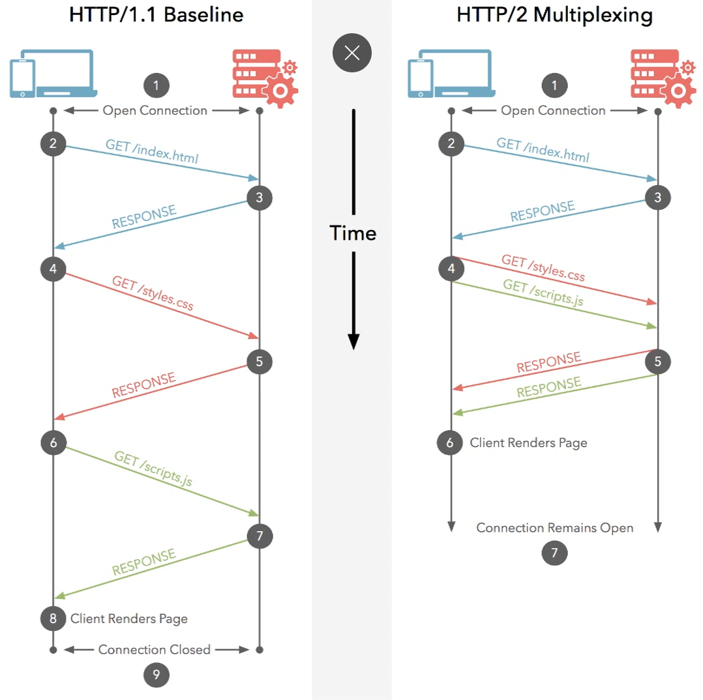
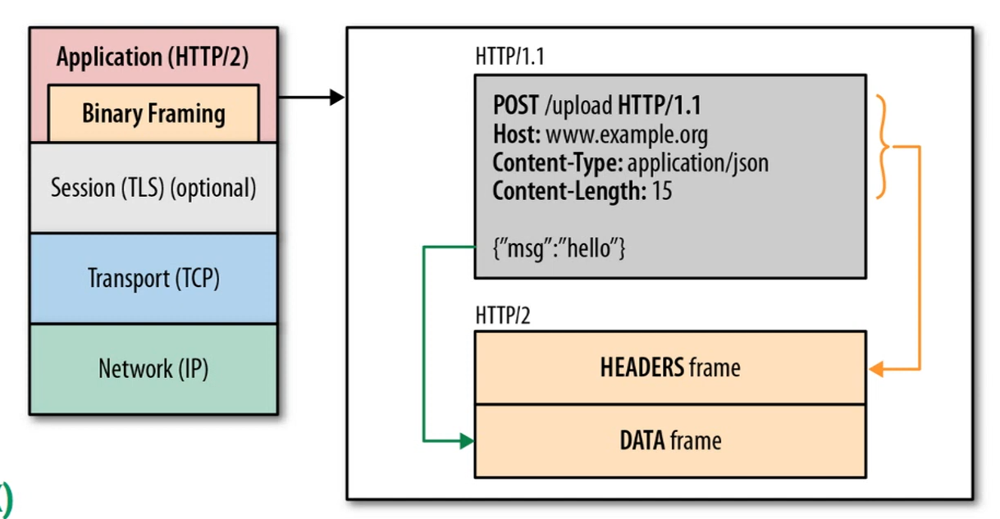

# HTTP/2 (Hypertext Transfer Protocol)

> Projetado para melhorar o desempenho do HTTP/1.1, reduzindo a latência e tornando o carregamento de recursos mais eficiente.

## Principais características

- **Multiplexação:** permite **enviar e receber várias requisições e respostas simultaneamente** pela mesma conexão TCP, evitando que cada recurso precise esperar o anterior terminar.
> Deixou de ser Sequencial

  

- **Server Push:** permite que o servidor envie recursos ao cliente antes mesmo de recebê-los como uma requisição específica. Foi criado para acelerar o carregamento, mas seu suporte prático nos navegadores foi amplamente descontinuado.

- **Compressão de cabeçalhos (HPACK):** reduz o tamanho dos cabeçalhos HTTP, economizando largura de banda ao comprimir e reutilizar informações repetidas.

  

- **Uso de TLS:** nos navegadores, o HTTP/2 é normalmente utilizado com HTTPS, que emprega TLS para **criptografar** a comunicação. A criptografia não faz parte obrigatória do protocolo HTTP/2 em si.