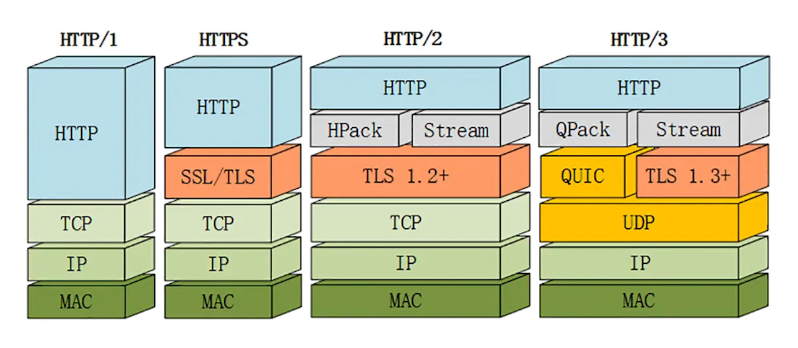

# HTTP/3 (Hypertext Transfer Protocol)

> Desenvolvido para melhorar o desempenho do HTTP, utilizando o protocolo QUIC no lugar do TCP.

## Principais características

- **QUIC:** protocolo de transporte que utiliza UDP e integra a criptografia TLS 1.3, permitindo conexões seguras com menor latência.

- **Multiplexação:** permite vários fluxos de comunicação simultâneos, reduzindo o problema de bloqueio causado pela perda de pacotes em uma conexão TCP.

- **Menor latência:** agiliza o estabelecimento de conexões seguras e pode melhorar o desempenho em redes instáveis.

- **Migração de conexão:** permite manter uma conexão ativa ao trocar de rede, como de Wi-Fi para dados móveis.

