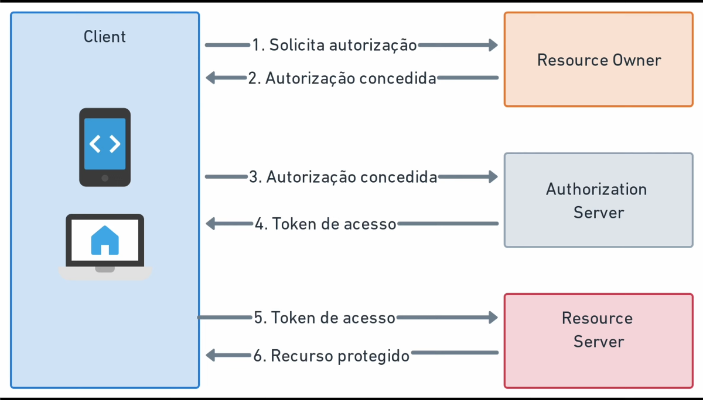
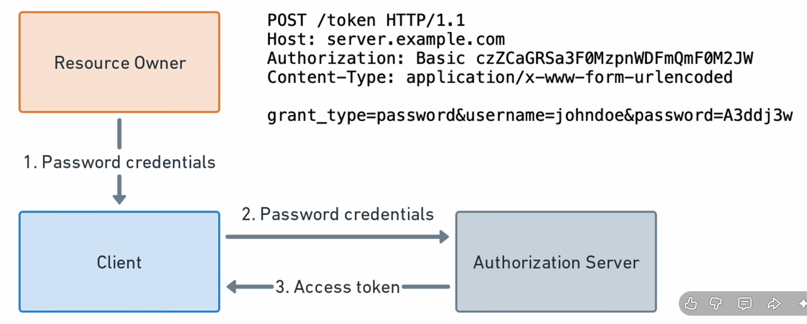
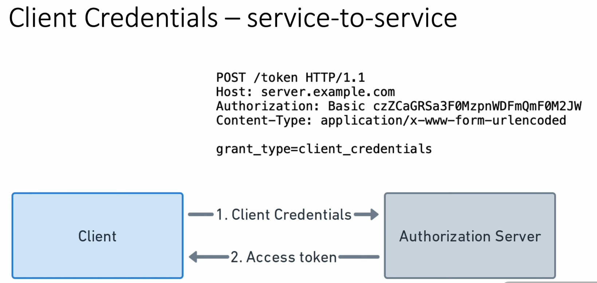
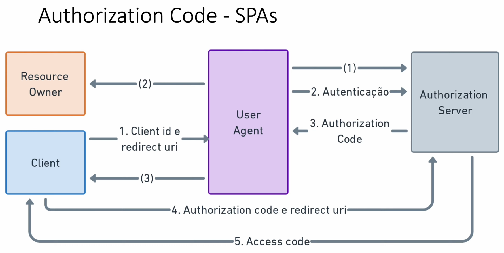
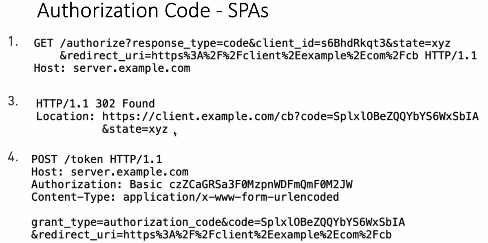
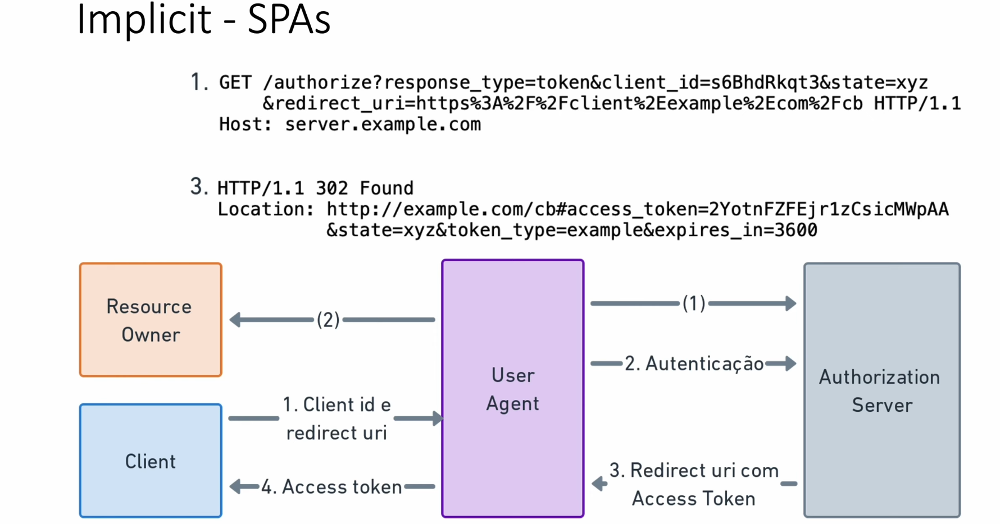

# OAuth 2.0 - Open Authorization

Protocolo de autorização que permite que uma aplicação terceira obtenha **acesso limitado a recursos protegidos** de um usuário, sem precisar compartilhar suas credenciais com essa aplicação.

- **Função:** autorização de acesso a recursos.
- **Utilização:** permitir que aplicações acessem serviços de terceiros.
- **Segurança:** utilização de tokens de acesso (Access Tokens).

> OAuth 2.0 é um protocolo de autorização, não de autenticação. Para autenticação, utiliza-se o OpenID Connect (OIDC), construído sobre OAuth 2.0.

## Papéis (Roles)

- **Resource Owner (RO):** proprietário do recurso, geralmente o usuário.
- **Resource Server (RS):** servidor onde estão armazenados os recursos protegidos.
- **Authorization Server (AS):** servidor responsável por autenticar o usuário e emitir tokens de acesso.
- **Client:** aplicação que solicita autorização para acessar os recursos.

## Fluxo de Autorização



1. **RO → Client:** solicita acesso a um recurso protegido.
2. **Client → RO:** solicita autorização para acessar o recurso em seu nome.
3. **RO → AS:** é redirecionado para o servidor de autorização e informa suas credenciais.
4. **AS → RO:** valida as credenciais e solicita a confirmação da autorização.
5. **AS → Client:** emite um código de autorização ou token, dependendo do fluxo utilizado.
6. **Client → AS:** obtém o Access Token.
7. **Client → RS:** solicita acesso ao recurso apresentando o Access Token.
8. **RS → Client:** valida o token e permite o acesso ao recurso.
9. **Client → RO:** retorna os dados solicitados.

## Tipos de Token

### Access Token (Token de Acesso)

Token utilizado para **conceder acesso a recursos protegidos**.

- É apresentado pelo Client ao Resource Server.
- Possui permissões e escopos associados.
- Geralmente possui tempo de expiração.
- Pode ser JWT ou opaco.

#### JWT - JSON Web Token

Formato de token cujas informações são representadas em JSON.

- Possui três partes: Header, Payload e Signature.
- Seu conteúdo pode ser decodificado e lido.
- Pode ser assinado para garantir integridade e autenticidade.
- Não é criptografado por padrão.

**Estrutura:**

`Header.Payload.Signature`

**Encoded:**

```text
eyJhbGciOiJIUzI1NiIsInR5cCI6IkpXVCJ9.
eyJzdWIiOiIxMjM0NTY3ODkwIiwibmFtZSI6
IkpvaG4gRG9lIiwiaWF0IjoxNTE2MjM5MDIyfQ.
SflKxwRJSMeKKF2QT4fwpMeJf36POk6yJV_adQssw5c
```

**Payload (Dados):**

```json
{
    "sub": "1234567890",
    "name": "John Doe",
    "iat": 1516239022
}
```

#### Token Opaco (Opaque Token)

Token cujo conteúdo não possui informações legíveis ou interpretáveis diretamente pelo cliente.

- Não permite identificar suas informações apenas decodificando o token.
- O Resource Server pode validá-lo por meio do Authorization Server (introspecção).
- Suas informações ficam associadas ao registro mantido pelo servidor.

### Refresh Token (Token de Renovação)

Token utilizado para **obter novos Access Tokens sem exigir que o usuário realize novamente o processo de autorização**.

- Utilizado quando o Access Token expira.
- Enviado ao Authorization Server.
- Geralmente possui validade maior que o Access Token.
- Frequentemente é opaco.
- Deve ser armazenado e protegido com segurança.

## Scopes (Escopos)

Representam as **permissões solicitadas e concedidas** a uma aplicação durante o processo de autorização.

Exemplos:
- Ler e-mails.
- Criar eventos na agenda.
- Acessar contatos.

> Determinam quais recursos e operações o Client poderá acessar.

## Fluxos de Autorização (Grant Types)

### Password (Resource Owner Password Credentials) - Descontinuado para novos sistemas

Utiliza diretamente as credenciais do usuário (login e senha) para obter um token.

- O usuário fornece suas credenciais diretamente ao Client.
- O Client envia as credenciais ao Authorization Server.
- Não utiliza redirecionamento para autorização.



> Não é recomendado e foi proibido pelas recomendações atuais de segurança do OAuth 2.0.

### Client Credentials - Service-to-Service

Utiliza as credenciais da própria aplicação cliente para obter um Access Token.

- Não envolve um usuário final.
- Utiliza Client ID e Client Secret.
- Indicado para comunicação entre serviços.



### Authorization Code - Aplicações Web e SPAs

Utiliza um código de autorização temporário para obter um Access Token.

- O usuário realiza a autorização no Authorization Server.
- O Client recebe um Authorization Code.
- O código é trocado por um Access Token.
- Para SPAs e aplicações públicas, utiliza-se PKCE para proteger o fluxo.





> É o fluxo recomendado para aplicações que envolvem usuários. Para SPAs, deve ser utilizado com PKCE.

### Implicit - Descontinuado

Fluxo no qual o Access Token é retornado diretamente ao navegador, sem a etapa de troca de um Authorization Code.

- O token é retornado diretamente pelo Authorization Server.
- Não utiliza Refresh Token nesse fluxo.
- Possui riscos de segurança relacionados à exposição do token.



> Não é recomendado pelas práticas atuais de segurança. Foi substituído pelo Authorization Code com PKCE.

## Qual fluxo utilizar?

- **Authorization Code + PKCE:** aplicações web, SPAs e aplicativos móveis.
- **Client Credentials:** comunicação entre serviços (Service-to-Service).