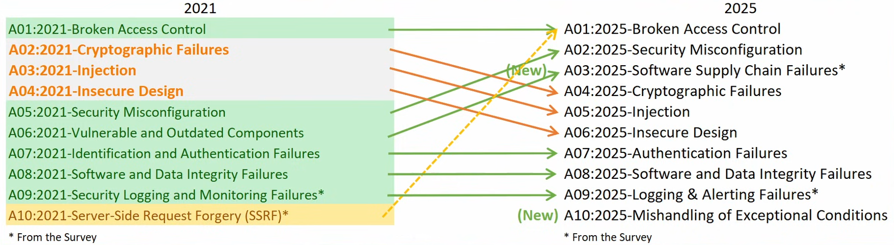

# OWASP Top 10:2025

**OWASP** -> Open Worldwide Application Security Project.

O **OWASP Top 10** é um documento de conscientização sobre os dez riscos de segurança mais críticos para aplicações web. Seu objetivo é orientar desenvolvedores e profissionais de segurança na identificação, prevenção e correção de vulnerabilidades.

## TOP 10

- [A01:2025 - Broken Access Control (Controle de Acesso Quebrado)](https://top10.owasp.org/2025/pt-BR/A01_2025-Broken_Access_Control/)
- [A02:2025 - Security Misconfiguration (Configuração Insegura)](https://top10.owasp.org/2025/pt-BR/A02_2025-Security_Misconfiguration/)
- [A03:2025 - Software Supply Chain Failures (Falhas na Cadeia de Suprimentos de Software)](https://top10.owasp.org/2025/pt-BR/A03_2025-Software_Supply_Chain_Failures/)
- [A04:2025 - Cryptographic Failures (Falhas Criptográficas)](https://top10.owasp.org/2025/pt-BR/A04_2025-Cryptographic_Failures/)
- [A05:2025 - Injection (Injeção)](https://top10.owasp.org/2025/pt-BR/A05_2025-Injection/)
- [A06:2025 - Insecure Design (Design Inseguro)](https://top10.owasp.org/2025/pt-BR/A06_2025-Insecure_Design/)
- [A07:2025 - Authentication Failures (Falhas de Autenticação)](https://top10.owasp.org/2025/pt-BR/A07_2025-Authentication_Failures/)
- [A08:2025 - Software or Data Integrity Failures (Falhas de Integridade de Software ou de Dados)](https://top10.owasp.org/2025/pt-BR/A08_2025-Software_or_Data_Integrity_Failures/)
- [A09:2025 - Security Logging and Alerting Failures (Falhas de Registro e Monitoramento de Segurança)](https://top10.owasp.org/2025/pt-BR/A09_2025-Security_Logging_and_Alerting_Failures/)
- [A10:2025 - Mishandling of Exceptional Conditions (Tratamento Incorreto de Condições Excepcionais)](https://top10.owasp.org/2025/pt-BR/A10_2025-Mishandling_of_Exceptional_Conditions/)

### Mudanças da versão anterior

---

## **A01:2025 - Broken Access Control (Controle de Acesso Quebrado)**

Ocorre quando uma aplicação não consegue aplicar corretamente as permissões de acesso dos usuários, permitindo que eles realizem ações ou acessem informações que deveriam estar restritas.

**Principais vulnerabilidades:**
- **IDOR (Insecure Direct Object References):** permite acessar informações de outros usuários pela manipulação de identificadores.
- **Elevação de privilégios:** um usuário comum consegue acessar funcionalidades de administrador.
- **Bypass de autorização:** acesso a páginas ou recursos restritos pela manipulação de URLs ou requisições.
- **Ausência de controle de acesso em APIs:** permite executar operações sem a devida autorização.

**Exemplo:** um usuário acessa `site.com/usuario/100` e, ao alterar o identificador para `101`, consegue visualizar os dados de outra pessoa.

**Prevenção:**
- Aplicar o princípio do menor privilégio (Least Privilege).
- Negar o acesso por padrão (Deny by Default).
- Validar as permissões no servidor, não apenas no front-end.
- Verificar se o usuário possui autorização para acessar ou modificar determinado recurso.

---

## **A02:2025 - Security Misconfiguration (Configuração Insegura)**

Ocorre quando servidores, frameworks, bancos de dados, aplicações ou serviços em nuvem possuem configurações inadequadas de segurança, deixando recursos e informações expostos.

**Principais vulnerabilidades:**
- Utilização de senhas e contas padrão.
- Serviços, portas e funcionalidades desnecessárias habilitadas.
- Mensagens de erro que revelam informações internas do sistema.
- Permissões incorretas em servidores e serviços de nuvem.
- Ausência de cabeçalhos de segurança HTTP.
- Ambientes de produção com configurações de desenvolvimento e depuração habilitadas.

**Exemplo:** um servidor de produção mantém o modo Debug habilitado, exibindo informações internas, caminhos de arquivos e detalhes da aplicação quando ocorre um erro.

**Prevenção:**
- Aplicar Hardening (endurecimento de segurança) nos ambientes.
- Remover serviços e funcionalidades desnecessárias.
- Alterar senhas e credenciais padrão.
- Desabilitar mensagens de erro detalhadas em produção.
- Manter servidores, frameworks e bibliotecas atualizados.
- Automatizar a verificação das configurações de segurança.

---

## **A03:2025 - Software Supply Chain Failures (Falhas na Cadeia de Suprimentos de Software)**

Ocorre quando algum componente, ferramenta, fornecedor ou processo envolvido no desenvolvimento, distribuição ou atualização de um software apresenta comprometimento de segurança.

A cadeia de suprimentos inclui bibliotecas, dependências, frameworks, ferramentas de desenvolvimento, repositórios e pipelines de CI/CD.

**Principais vulnerabilidades:**
- Utilização de bibliotecas com vulnerabilidades conhecidas.
- Dependências desatualizadas ou sem manutenção.
- Comprometimento de fornecedores de software.
- Ferramentas de desenvolvimento comprometidas.
- Atualizações de software contendo código malicioso.
- Falta de controle sobre as dependências utilizadas.

**Exemplo:** uma aplicação utiliza uma biblioteca de terceiros que foi comprometida. Uma atualização dessa dependência introduz código malicioso no projeto.

**Prevenção:**
- Verificar a origem e a confiabilidade das dependências.
- Manter bibliotecas e frameworks atualizados.
- Utilizar ferramentas de análise de dependências.
- Monitorar vulnerabilidades conhecidas.
- Restringir o acesso aos repositórios e pipelines de CI/CD.
- Utilizar SBOM (Software Bill of Materials) para documentar os componentes utilizados no software.

---

## **A04:2025 - Cryptographic Failures (Falhas Criptográficas)**

Ocorre quando mecanismos criptográficos são inexistentes, inadequados ou implementados incorretamente, permitindo que informações sensíveis sejam expostas ou comprometidas.

**Principais vulnerabilidades:**
- Armazenamento de senhas em texto puro (Plain Text).
- Utilização de algoritmos criptográficos fracos ou obsoletos.
- Transmissão de informações sensíveis sem criptografia.
- Gerenciamento inadequado de chaves criptográficas.
- Utilização de números aleatórios previsíveis.
- Certificados digitais inválidos ou mal configurados.

**Exemplo:** uma aplicação armazena senhas diretamente no banco de dados, sem utilizar funções apropriadas de hash. Caso o banco seja comprometido, os atacantes conseguem visualizar as senhas.

**Prevenção:**
- Utilizar HTTPS com TLS para proteger a comunicação.
- Armazenar senhas utilizando algoritmos apropriados, como Argon2id, bcrypt ou scrypt.
- Utilizar algoritmos criptográficos confiáveis e atualizados.
- Proteger e gerenciar adequadamente as chaves criptográficas.
- Evitar armazenar informações sensíveis desnecessariamente.

---

## **A05:2025 - Injection (Injeção)**

Ocorre quando dados fornecidos pelo usuário são interpretados como comandos ou instruções pelo sistema, permitindo que um atacante execute operações não autorizadas.

Geralmente acontece quando entradas não confiáveis são utilizadas diretamente em consultas, comandos ou interpretadores sem a devida validação e proteção.

**Principais vulnerabilidades:**
- **SQL Injection:** manipulação de consultas SQL para acessar ou modificar informações no banco de dados.
- **XSS (Cross-Site Scripting):** injeção de scripts maliciosos em páginas web executadas no navegador de outros usuários.
- **Command Injection:** execução de comandos arbitrários no sistema operacional.
- **LDAP Injection:** manipulação de consultas LDAP.

**Exemplo:** uma aplicação monta uma consulta SQL concatenando diretamente os dados informados pelo usuário. Um atacante pode inserir instruções SQL para modificar o comportamento da consulta original.

**Prevenção:**
- Utilizar consultas parametrizadas (Prepared Statements).
- Validar e sanitizar as entradas dos usuários.
- Evitar concatenar diretamente dados externos em consultas SQL.
- Utilizar mecanismos de escape adequados ao contexto.
- Aplicar políticas de segurança para reduzir os impactos de possíveis injeções.

---

## **A06:2025 - Insecure Design (Design Inseguro)**

Ocorre quando uma aplicação apresenta falhas em sua arquitetura, planejamento ou lógica de negócio, permitindo comportamentos inseguros mesmo que o código esteja implementado corretamente.

Diferentemente de uma falha de implementação, o problema está na própria concepção do sistema, que não considera adequadamente os requisitos e riscos de segurança.

**Principais vulnerabilidades:**
- Ausência de requisitos de segurança durante o planejamento.
- Falta de modelagem de ameaças (Threat Modeling).
- Regras de negócio que permitem comportamentos indevidos.
- Ausência de limites para operações sensíveis.
- Falta de mecanismos para impedir alterações indevidas no fluxo da aplicação.

**Exemplo:** um sistema de compras permite que o usuário altere o valor de um produto diretamente na requisição enviada ao servidor, pois a aplicação não possui regras de negócio que garantam a validação do preço.

**Prevenção:**
- Aplicar o conceito de Secure by Design (Segurança desde a concepção).
- Realizar modelagem de ameaças.
- Definir requisitos de segurança antes da implementação.
- Implementar e validar corretamente as regras de negócio.
- Utilizar padrões e arquiteturas de desenvolvimento seguro.
- Testar cenários de uso indevido da aplicação.

---

## **A07:2025 - Authentication Failures (Falhas de Autenticação)**

Ocorre quando os mecanismos responsáveis por verificar a identidade dos usuários são inadequados, permitindo que atacantes se passem por usuários legítimos ou obtenham acesso indevido às contas.

**Principais vulnerabilidades:**
- **Brute Force:** tentativa automatizada de descobrir senhas por meio de diversas combinações.
- **Credential Stuffing:** utilização de credenciais vazadas em outros serviços para tentar acessar uma aplicação.
- Utilização de senhas fracas ou padrão.
- Ausência de autenticação multifator (MFA).
- Gerenciamento inadequado de sessões.
- Falhas na validação de certificados e credenciais.

**Exemplo:** um sistema permite tentativas ilimitadas de login. Um atacante utiliza um script para testar milhares de combinações de senhas até conseguir acessar uma conta.

**Prevenção:**
- Exigir senhas fortes e bloquear credenciais comprometidas.
- Implementar autenticação multifator (MFA).
- Aplicar limites de tentativas de autenticação (Rate Limiting).
- Utilizar mecanismos seguros de gerenciamento de sessões.
- Invalidar sessões após o logout.
- Proteger tokens e credenciais de autenticação.

---

## **A08:2025 - Software or Data Integrity Failures (Falhas de Integridade de Software ou de Dados)**

Ocorre quando uma aplicação não verifica adequadamente a integridade e a confiabilidade de códigos, atualizações, arquivos ou dados utilizados pelo sistema.

O problema está na aceitação e utilização de informações ou componentes não confiáveis como se fossem legítimos.

**Principais vulnerabilidades:**
- Utilização de plugins ou bibliotecas de fontes não confiáveis.
- Atualizações de software sem verificação de integridade.
- Falta de assinatura digital em arquivos e atualizações.
- Desserialização de dados não confiáveis (Insecure Deserialization).
- Pipelines de CI/CD sem mecanismos adequados de verificação.
- Alteração não autorizada de informações e objetos da aplicação.

**Exemplo:** uma aplicação realiza uma atualização baixando um arquivo de um servidor externo, mas não verifica sua assinatura digital ou integridade antes de executá-lo. Um atacante consegue substituir o arquivo original por uma versão maliciosa.

**Prevenção:**
- Verificar assinaturas digitais e hashes dos arquivos.
- Utilizar fontes confiáveis para dependências e atualizações.
- Validar dados antes de realizar a desserialização.
- Proteger os pipelines de CI/CD.
- Restringir alterações em arquivos e componentes críticos.
- Implementar mecanismos de verificação de integridade.

---

## **A09:2025 - Security Logging and Alerting Failures (Falhas de Registro e Monitoramento de Segurança)**

Ocorre quando uma aplicação não registra, monitora ou alerta adequadamente sobre eventos relevantes de segurança, dificultando a identificação de ataques e a resposta a incidentes.

Os registros (Logs) são fundamentais para identificar atividades suspeitas, investigar incidentes e compreender o comportamento de uma aplicação.

**Principais vulnerabilidades:**
- Ausência de registros de eventos importantes.
- Falta de monitoramento contínuo.
- Ausência de alertas para atividades suspeitas.
- Registros insuficientes de tentativas de autenticação.
- Exposição de informações sensíveis nos arquivos de log.
- Falta de proteção contra alterações ou exclusões dos registros.

**Exemplo:** um atacante realiza centenas de tentativas de login em uma conta. Como a aplicação não registra essas tentativas nem gera alertas, a atividade maliciosa passa despercebida.

**Prevenção:**
- Registrar eventos relevantes de segurança.
- Monitorar continuamente os registros da aplicação.
- Configurar alertas para atividades suspeitas.
- Proteger os arquivos de log contra alterações indevidas.
- Evitar armazenar senhas, tokens e outras informações sensíveis nos registros.
- Implementar mecanismos de detecção e resposta a incidentes.

---

## **A10:2025 - Mishandling of Exceptional Conditions (Tratamento Incorreto de Condições Excepcionais)**

Categoria introduzida em 2025. Ocorre quando uma aplicação não consegue prevenir, identificar ou tratar corretamente situações inesperadas, como erros, exceções, falhas de processamento e condições anormais de execução.

Essas falhas podem provocar comportamentos inesperados, travamentos, exposição de informações e até comprometer os mecanismos de segurança.

**Principais vulnerabilidades:**
- Tratamento inadequado de exceções.
- Exposição de informações sensíveis em mensagens de erro.
- Falta de validação de parâmetros ausentes ou inválidos.
- Falhas na verificação de valores nulos (Null Pointer).
- Continuação da execução mesmo após uma falha crítica.
- Falhas na aplicação do princípio *Fail Secure*.

**Exemplo:** um sistema realiza uma operação financeira e ocorre uma falha durante a validação do pagamento. Em vez de interromper a operação, a aplicação continua o processamento e libera o pedido sem confirmar o pagamento.

**Prevenção:**
- Implementar tratamento adequado de exceções.
- Validar entradas, parâmetros e estados da aplicação.
- Evitar expor detalhes internos em mensagens de erro.
- Garantir que falhas críticas interrompam operações inseguras.
- Aplicar o princípio *Fail Secure* (falhar de forma segura).
- Registrar erros e monitorar comportamentos inesperados.

---

## **Resumo para memorização**

| Categoria | Principal preocupação |
|---|---|
| A01 - Broken Access Control | Quem pode acessar e fazer o quê? |
| A02 - Security Misconfiguration | O sistema está configurado corretamente? |
| A03 - Software Supply Chain Failures | Os componentes e fornecedores são confiáveis? |
| A04 - Cryptographic Failures | Os dados estão protegidos criptograficamente? |
| A05 - Injection | Entradas maliciosas podem ser executadas como comandos? |
| A06 - Insecure Design | A aplicação foi planejada considerando a segurança? |
| A07 - Authentication Failures | A identidade do usuário está sendo verificada corretamente? |
| A08 - Software or Data Integrity Failures | A integridade dos códigos e dados está sendo garantida? |
| A09 - Security Logging and Alerting Failures | Os eventos suspeitos são registrados e detectados? |
| A10 - Mishandling of Exceptional Conditions | O sistema trata corretamente situações inesperadas? |