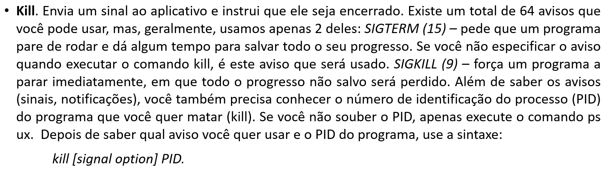

# Comandos de Instalações e Configurações
- **Sudo**: Fornece **privilégios de administrador** ao usuário atual
- **[Chmod](chmod.md)**: É usado para ler, escrever e executar **permissões de arquivos e diretórios**. 
- **Chown**: Permite que você mude ou transfira a **propriedade de um arquivo para um nome de usuário específico**.
- **Jobs**: **Mostra** todos os trabalhos junto com os seus **status de desenvolvimento**
- **Uname**: Significa **Unix Name**, mostra informações **detalhadas sobre seu sistema Linux**.
- **Top**: Equivalente ao **Gerenciador de Tarefas** do Windows.
- **History**: **Histórico** de quais comandos já usou antes.
- **Man**: "Manual" de como usar um comando especifico, equivalente ao **help** do windows
- **Echo**: Mover alguns dados para um arquivo
  + EX: Adicionar o texto **"Olá, meu nome é John"** em um arquivo chamado `name.txt`, digite `echo Olá, meu nome é John >> name.txt`
- **zip**, **unzip**: Compactar com `zip` e Descompactar com `unzip`.
- **Ping**: Verificar **Status da conexão** com o servidor.
- **Wget**: Baixar arquivos da internet.
- **Hostname**: saber o **nome do seu host/network**.
- **useradd**, **userdel**: `useradd` para adicionar um usuário, `userdel` para remover um usuário.
- **🛑Kill🛑**: 
- **Df**: Verificar quanto do **disco (HD/SSD) já foi usado**.

---

# Comando de Manipulação de arquivos
- **Pwd**: Encontrar o caminho para a **pasta atual** em que você está no CMD.
- **Cd**: **Navegar** pelo filesystem do Linux.
  + Cd vem de **Change Directory**
- **Ls**: Visualizar conteúdo dentro de um diretório.
  + Ls vem de **List**
- **Cat**: Usado para **Visualizar o conteúdo de um arquivo** na saída padrão.
  + Cat vem de **Concatenar**
- **Cp**: **Copiar arquivos** do diretóreio atual.
  + Cp vem de **Copy**
- **Mv**: **Mover** arquivos, também pode renomear arquivos.
- **Mkdir**: **Criar** uma nova pasta. 
  + Mkdir vem de **Make Directory**
- **Rmdir**: **Apagar** um diretório vazio
  + Rmdir vem de **Remove Directory**
- **Rm**: **Apagar um diretório e todos os conteúdos** que estivem dentro.
- **Touch**: Criar **novos arquivos em branco**.
- **Locate**: Localizar um arquivo no **sistema todo**.
- **Find**: Similar ao comando locate, mas busca em um **diretório específico**.
- **Grep**: Permite que você procure através de todo texto dentro de um arquivo específico.
- **Du**: Verifica o quanto de espaço um arquivo ou um diretório ocupa.
- **Head**: Mostra as 10 primeiras linhas de arquivo de Texto.
- **Tail**: Mostra as 10 ~ultimas linhas de arquivo de Texto.
- **Diff**: Compara o conteúdo de dois arquivos linha por linha.
  + Diff vem de **Diferença**
- Tar: Arquiva múltiplos arquivos em um tarball - fomato de arquivo linux que é similar ao formato zip.